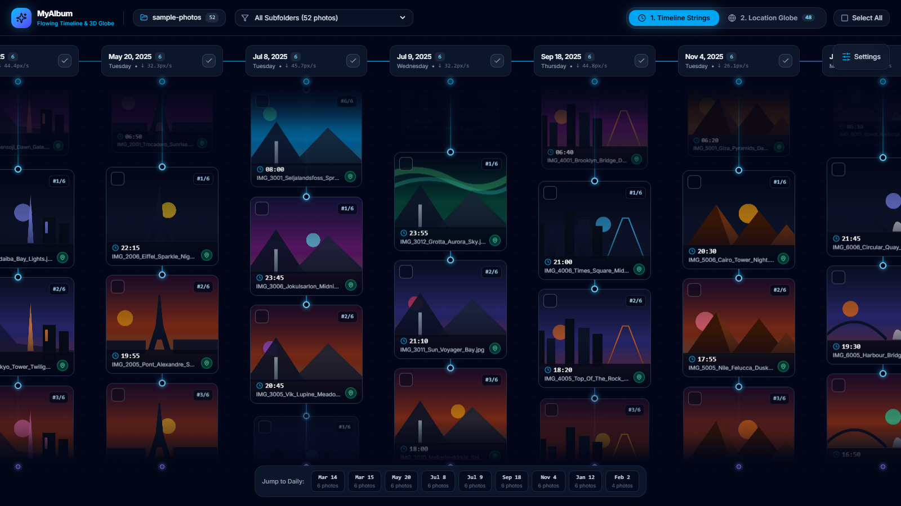
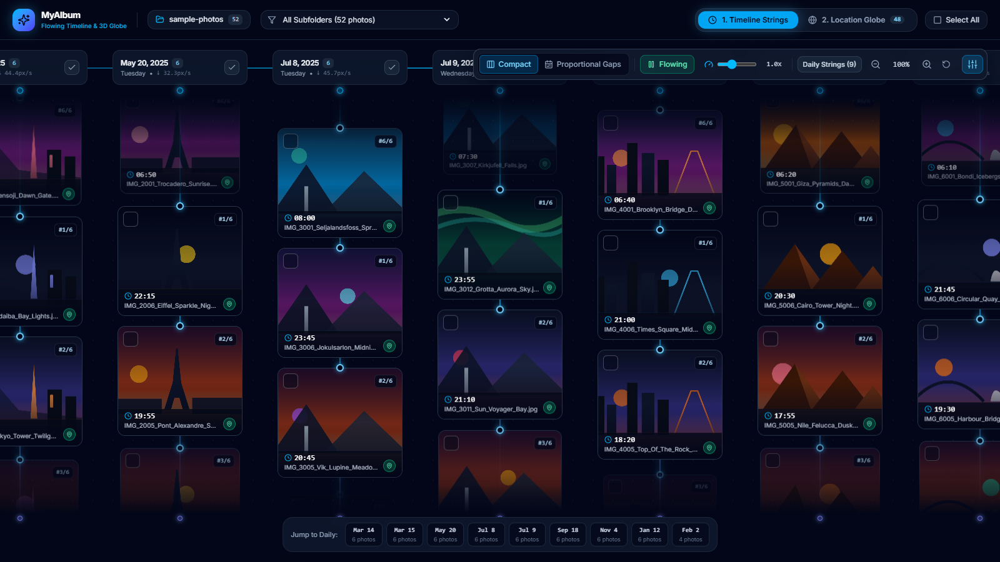
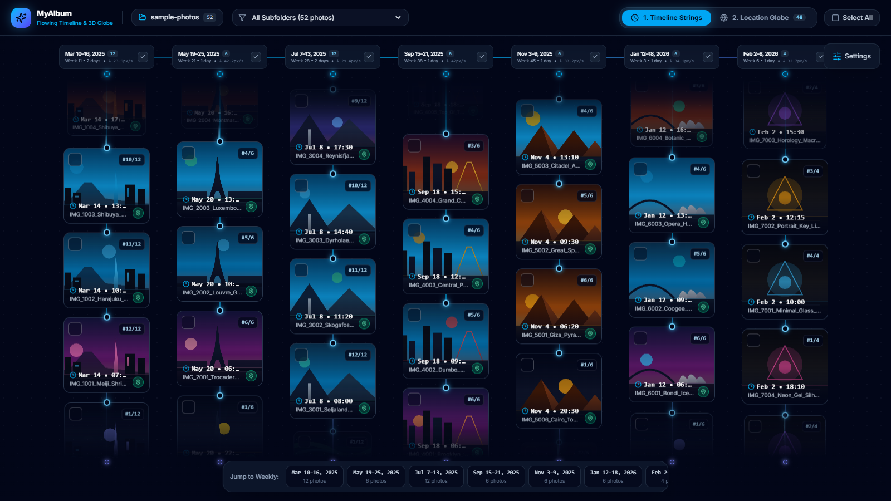
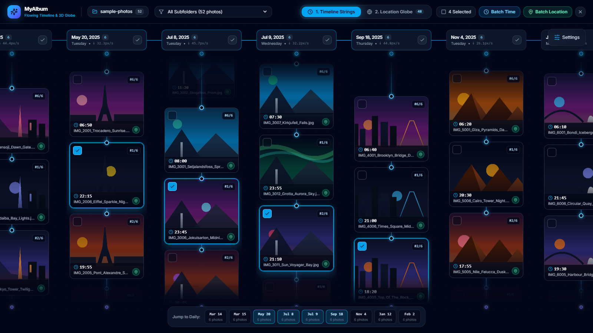
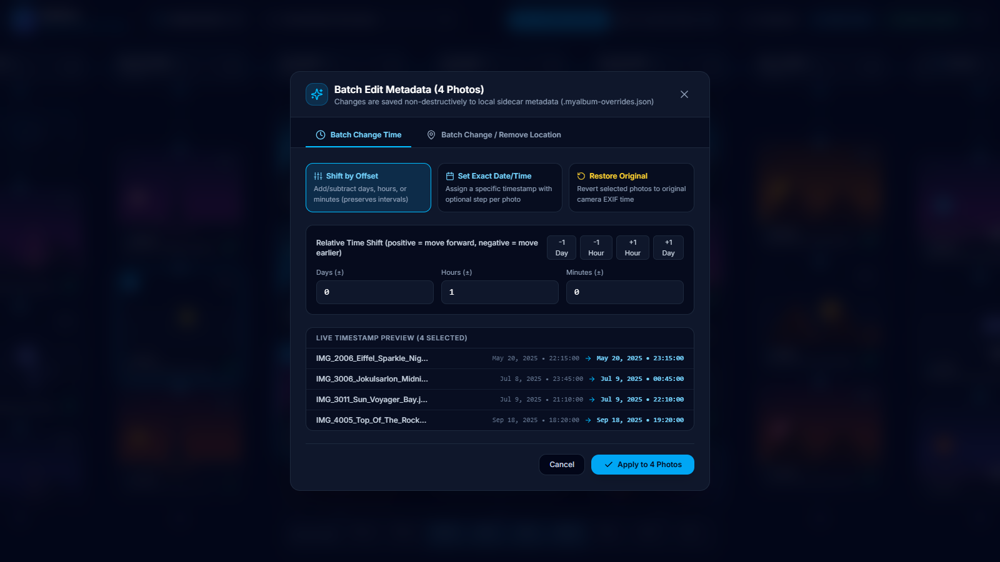
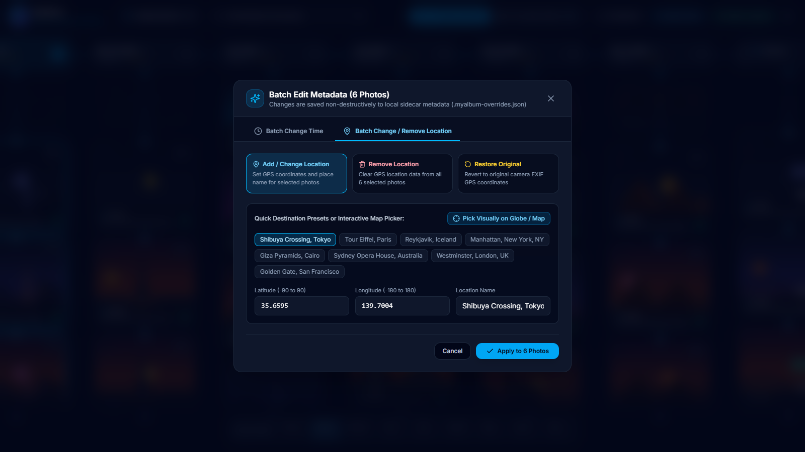
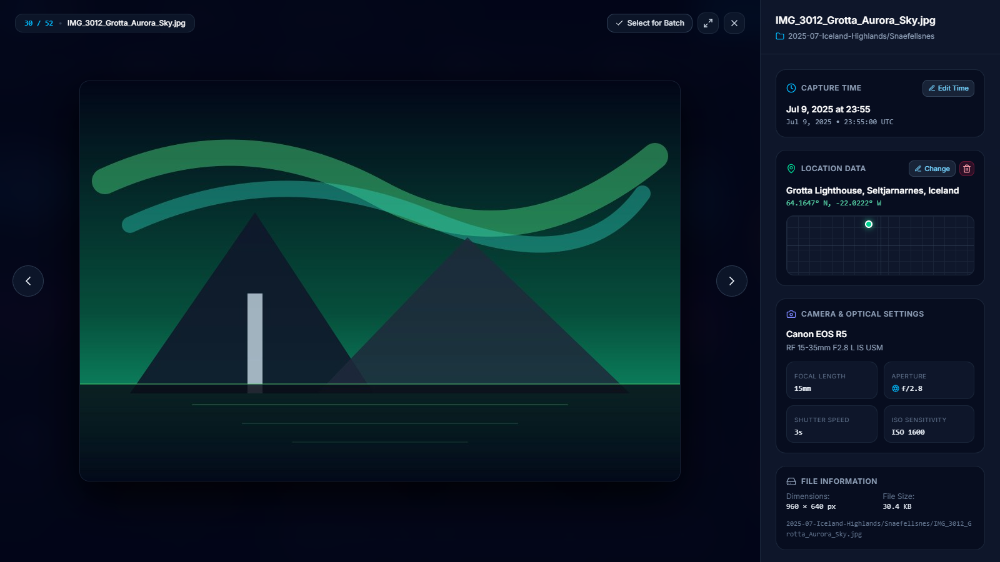
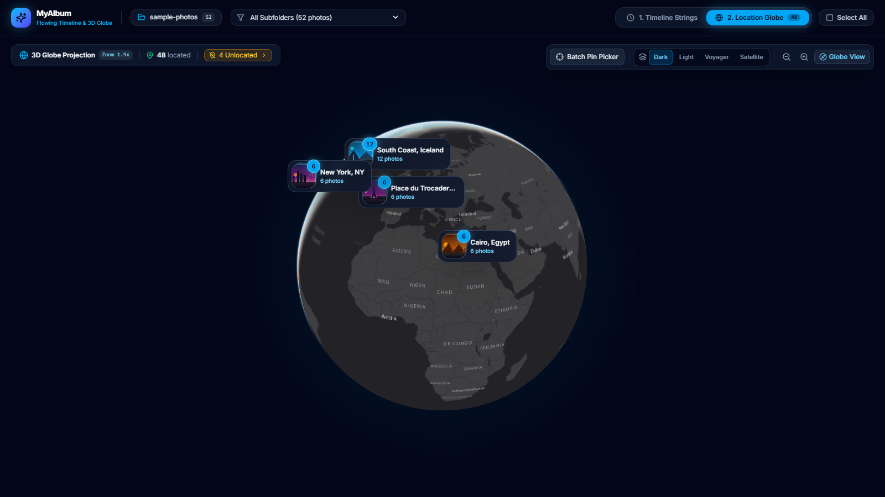
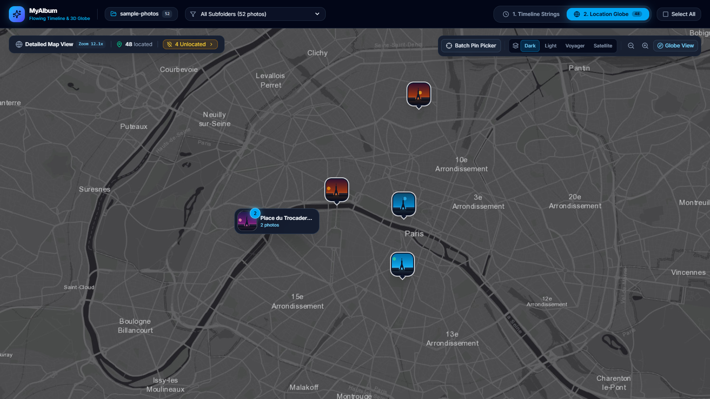

# MyAlbum — Interactive Photo Timeline & 3D Globe Visualizer

**MyAlbum** is a modern full-stack web application built with **React 19**, **TypeScript**, **Vite**, **Tailwind CSS v4**, **MapLibre GL JS v5**, and **Express** that visualizes a folder of photos (including nested subfolders) in two interactive modes—**Flowing Timeline View** and **3D Globe / Clustered Map View**—with non-destructive batch metadata editing for capture timestamps and GPS locations.

---

## ✨ Key Features

### 1. Flowing Timeline View (`src/components/TimelineView.tsx`)
- **Horizontal Chronological Axis**: Groups photos along a horizontal timeline from **oldest (left)** to **newest (right)**, centered automatically on screen.
- **Infinite Downward-Flowing Vertical Strings**:
  - Each column represents a time bucket ("vertical string") containing photos ordered **newest (top)** to **oldest (bottom)** by default.
  - Every string flows continuously downwards in an infinite loop at its own deterministic speed (`22 px/s` – `48 px/s`), with smooth `smoothstep` and CSS `mask-image` fade/scale transitions at both ends of the string.
- **Horizontal-Only Panning & Crisp Pinned Top Time Cards**:
  - Dragging or scrolling pans strictly along the horizontal axis (`pan.y === 0`).
  - Top time cards remain anchored at the top of each string and resize natively via layout dimensions (`width`, `height`, `fontSize`, `padding`, `borderRadius`) without bitmap-blurring `transform: scale(...)`, staying razor-sharp up to `225%` zoom.
- **Multi-Granularity String Merging with Smooth FLIP & Ghost Animations**:
  - When zooming out shrinks time cards below `146px`, strings automatically merge across four granularity levels: **Daily (`YYYY-MM-DD`) → Weekly (`YYYY-Www`) → Monthly (`YYYY-MM`) → Yearly (`YYYY`)**.
  - Crossing granularity thresholds triggers a smooth **380ms FLIP & Ghost Convergence/Fan-Out Animation**: outgoing strings slide horizontally toward their merged target while cross-fading, and newly merged or unmerged strings glide from their photo-weighted source centroids while preserving flow phase and momentum.
- **Vertical String Drag/Swipe Scrubbing & Smooth Momentum Decay**:
  - Drag or swipe vertically directly on any string (or its photo cards) to **fast-forward (downwards)** or **fast-backward / rewind (upwards)**.
  - When releasing the drag/swipe, the extra velocity boost smoothly decays back to the string's normal flow speed via exponential half-life decay (`halfLife = 0.28s`).
  - Hovering the top or bottom anchor zones of a string also triggers instant fast-backward (`↑↑`) or fast-forward (`↓↓`).
- **Hover-Expandable Settings Bar & Quick-Jump Scrubber**:
  - The top-right timeline options bar is collapsed by default into a compact **Settings** button that overlaps the top time cards and smoothly expands on hover to reveal **Compact vs. Proportional Gaps**, **Flow Play/Pause**, **Speed Multiplier (`0.25x` – `2.5x`)**, **Granularity Badge**, and **Zoom / Reset** controls.
  - A bottom chronological quick-jump bar lets you glide directly to any string bucket.

---

### 2. 3D Globe & Clustered Location View (`src/components/MapView.tsx`)
- **3D Interactive Globe at Low Zoom**:
  - Powered by **MapLibre GL JS v5** with `globe` projection and atmospheric glow when zoomed out, transitioning seamlessly to a high-detail 2D street or satellite map as you zoom in.
- **Spatial Clustering with Photo Count Badges (`src/utils/mapClusters.ts`)**:
  - Uses **Supercluster** to aggregate dense photo locations into stacked thumbnail cluster markers displaying the exact photo count.
  - Clicking a cluster smoothly zooms into its expansion zoom level and opens the **Cluster Photos Inspector Popover** to browse or batch-select photos in that region.
- **Back-Hemisphere Culling & 4 Map Themes**:
  - Automatically hides markers on the far side of the 3D globe so markers never bleed through the Earth.
  - Switch between **Dark Matter**, **Positron Light**, **Voyager Street**, and **Esri World Imagery (Satellite)** basemaps.
- **Unlocated Photos Drawer & Interactive Pin Picker**:
  - Dedicated drawer lists all photos without GPS metadata so you can select them and assign coordinates directly on the globe/map using the interactive crosshair pin-picker mode.

---

### 3. Batch Time & Location Editing (`src/components/BatchEditModal.tsx`)
- **Flexible Multi-Selection**:
  - Select individual photos (`Click` checkbox or `Shift/Ctrl/Cmd + Click`), entire timeline strings, map clusters, all unlocated photos, or all visible photos.
- **Batch Time Adjustment**:
  - **Shift by Relative Offset**: Shift all selected photos by `± Days / Hours / Minutes` while preserving exact relative time intervals between photos.
  - **Set Exact Date & Time**: Assign a specific wall-clock date/time with an optional sequential minute step (`+N min` per photo).
  - **Restore Original Time**: Revert edited timestamps back to their original camera EXIF capture times.
  - Includes a live **Before → After** preview table before saving.
- **Batch Location Adjustment**:
  - **Add / Change Location**: Set coordinates by clicking directly on the map/globe, picking from world city/landmark presets, or entering latitude, longitude, and location name.
  - **Remove Location**: Strip GPS coordinates from all selected photos in one action.
- **Non-Destructive Sidecar Persistence**:
  - All metadata edits are persisted in `.myalbum-overrides.json` inside the active photo folder, keeping original image files untouched and corruption-free.

---

### 4. Photo Lightbox & EXIF Inspector (`src/components/PhotoLightbox.tsx`)
- Click any photo in either view to open a full-screen animated modal (`framer-motion`) featuring:
  - Interactive click-to-zoom (`1x` ↔ `2x`) and keyboard navigation (`←`, `→`, `Esc`).
  - Full capture timestamp (with wall-clock timezone preservation), GPS coordinates, location name, and mini coordinate radar.
  - Camera make & model, lens model, focal length (`mm`), aperture (`f/`), shutter speed, ISO sensitivity, dimensions, file size, and relative subfolder path.
  - One-click shortcut to open the Batch Editor for the currently viewed photo.

---

## 📸 Screenshots

Captured at 1600×900 from the built-in demo album, which is generated on first launch.

### Flowing Timeline View

Photos are grouped into vertical strings, newest first.



### Hover-Expandable Settings Bar

Compact or proportional gaps, flow play/pause, speed multiplier, granularity badge, and zoom controls.



### Multi-Granularity String Merging

Zooming out merges daily strings into weekly strings, then monthly and yearly as you zoom further.



### Multi-Selection & Batch Actions

Selected photos show a count, with Batch Time and Batch Location actions in the header.



### Batch Time Adjustment

A live Before → After preview shows the new timestamps before anything is saved.



### Batch Location Adjustment

Pick a city or landmark preset, the map picker, or exact latitude and longitude, then apply the location to every selected photo at once.



### Photo Lightbox & EXIF Inspector

Capture time, GPS location, and camera settings for each photo.



### 3D Globe & Clustered Map View

Photos cluster by location, with count badges on the rotatable globe.



### Exact Per-Photo Locations

Zooming into a cluster reveals each photo as its own pin at its exact GPS coordinates.



---

## 🛠️ Tech Stack

| Layer | Technologies |
| :--- | :--- |
| **Frontend** | React 19, TypeScript 5.7, Vite 6, Tailwind CSS v4, Framer Motion, Lucide React |
| **Map & Spatial** | MapLibre GL JS v5 (`globe` projection), Supercluster |
| **Backend & Media** | Node.js, Express 4 (integrated as Vite middleware + standalone server), `exifr` (EXIF/GPS parser), `sharp` (demo album generator) |
| **Testing** | Vitest 3, Supertest, JSDOM, Playwright (end-to-end) |

---

## 📁 Project Structure

```text
MyAlbum/
├── server/
│   ├── app.ts                 # Express REST API, recursive folder scanner, EXIF parser & sidecar store
│   ├── demoGenerator.ts       # Generates sample photos across nested subfolders using Sharp
│   └── index.ts               # Standalone Express server entry point
├── src/
│   ├── components/
│   │   ├── BatchEditModal.tsx # Floating selection dock & batch time/location editor modal
│   │   ├── FolderBrowserModal.tsx # Interactive local filesystem directory picker modal
│   │   ├── MapView.tsx        # 3D Globe / MapLibre GL view with Supercluster & pin picker
│   │   ├── PhotoLightbox.tsx  # Full-screen photo viewer & camera EXIF inspector
│   │   └── TimelineView.tsx   # Horizontal timeline with flowing vertical strings & zoom merging
│   ├── types/
│   │   └── photo.ts           # Shared TypeScript interfaces for photos, EXIF, clusters & batch edits
│   ├── utils/
│   │   ├── mapClusters.ts     # Supercluster indexing, cluster querying & globe hemisphere visibility math
│   │   └── timelineMath.ts    # Timeline bucketing, zoom granularity merging, FLIP transitions & swipe decay math
│   ├── App.tsx                # Top-level application shell, header bar, folder scanner & state management
│   ├── index.css              # Tailwind CSS v4 imports & timeline merge/unmerge keyframe animations
│   └── main.tsx               # React 19 root mount
├── e2e/
│   ├── fixtures.ts                   # Shared Playwright fixtures and on-screen element helpers
│   ├── lightbox.spec.ts              # Lightbox opening, EXIF details & Escape to close
│   ├── map.spec.ts                   # Globe clusters, flat-map photo pins & batch pin picker
│   ├── selection-and-batch.spec.ts   # Day-string selection and batch location/time dialogs
│   └── timeline.spec.ts              # String layout, settings bar, zoom merging & reset view
├── tests/
│   ├── components/
│   │   └── timeline-view.dom.test.ts # JSDOM tests for horizontal panning, pinned cards & merging
│   ├── helpers/
│   │   └── album-fixtures.ts         # Shared trip album fixture creation and cleanup
│   ├── map/
│   │   └── clusters.test.ts          # Globe clustering and high-zoom marker expansion
│   ├── server/
│   │   ├── batch-edits.test.ts       # Batch time & location edits with sidecar persistence
│   │   ├── demo-album.test.ts        # Built-in demo album generation and scanning
│   │   ├── edge-cases.test.ts        # Empty inputs, coordinate clamping & API error paths
│   │   └── exif-metadata.test.ts     # EXIF + GPS embedding and parsing round-trip
│   └── timeline/
│       ├── day-columns.test.ts       # Column ordering, spacing modes & loop transitions
│       ├── granularity-merge.test.ts # Daily → weekly → monthly → yearly string merging
│       └── pan-and-velocity.test.ts  # Centered pan clamping & string end fast-forward/rewind
├── package.json
├── playwright.config.ts       # Playwright config for the end-to-end suite
├── tsconfig.json
└── vite.config.ts             # Vite config with integrated Express /api middleware and Vitest settings
```

---

## 🚀 Getting Started

### Prerequisites
- **Node.js** `>= 20.x` and **npm**

### 1. Install Dependencies
```bash
npm install
```

### 2. Start the Development Server
```bash
npm run dev
```
Open **`http://localhost:5173`** in your browser.
- On first launch, MyAlbum automatically generates and loads a **52-photo Demo Album** (`./sample-photos`, organized into trip folders such as `2025-03-Tokyo-Spring` and `2025-07-Iceland-Highlands`) so you can immediately explore both views.
- Enter any local folder path in the top bar or click **Browse** to scan your own photo library (supports `.jpg`, `.jpeg`, `.png`, `.webp`, `.avif`, `.gif`, `.heic`, `.tiff`).

### 3. Run the Automated Test Suite
```bash
npm test            # Vitest unit, API, and component tests
npm run test:e2e    # Playwright end-to-end browser tests (starts the dev server automatically)
```
The first end-to-end run needs the Chromium browser: `npx playwright install chromium`.

GitHub Actions runs both suites on every push and pull request (see `.github/workflows/test.yml`).

### 4. Build for Production
```bash
npm run build
```

---

## 🎮 Controls & Shortcuts

| Action | Timeline View | Location (3D Globe / Map) View | Lightbox Modal |
| :--- | :--- | :--- | :--- |
| **Pan / Move** | Drag horizontally or horizontal trackpad scroll | Drag to rotate globe / pan map | — |
| **Zoom In / Out** | Mouse wheel, pinch, or `+` / `-` in Settings bar | Mouse wheel, double-click, or `+` / `-` controls | Click image to toggle `1x` / `2x` zoom |
| **Fast-Forward / Rewind String** | Drag/swipe vertically on any string, or hover string top/bottom ends | — | — |
| **Adjust Flow Speed** | Hover **Settings** button → drag speed slider (`0.25x` – `2.5x`) | — | — |
| **Select Photo(s)** | Click card checkbox or `Shift/Ctrl/Cmd + Click` card; click string checkmark to select entire string | Click marker checkbox, or click cluster → **Select All in Cluster** | Click **Edit Time / Location** |
| **Navigate Photos** | — | — | `←` / `→` arrow keys or side buttons (`Esc` to close) |

---

## 🔌 REST API Endpoints

| Method | Endpoint | Description |
| :--- | :--- | :--- |
| `POST` | `/api/scan` | Recursively scans `{ folderPath }`, parses EXIF/GPS metadata, merges `.myalbum-overrides.json`, and returns `PhotoItem[]`. |
| `POST` | `/api/demo` | Generates (if needed) and scans the built-in `./sample-photos` demo library with nested subfolders. |
| `GET` | `/api/browse?dir=...` | Lists system drives, parent path, subdirectories, and image counts for the interactive folder picker. |
| `GET` | `/api/photo?path=...` | Streams a local photo file safely to the browser with path/extension validation. |
| `PATCH` | `/api/photos/batch` | Applies batch timestamp (`shift` / `exact` / `reset`) and/or location (`set` / `remove`) updates to `.myalbum-overrides.json`. |
